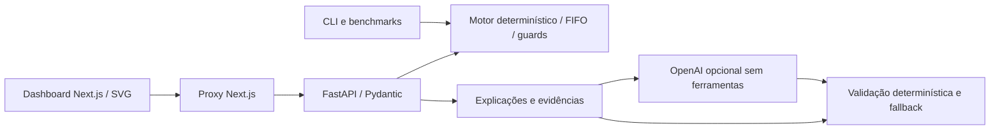

# PeakGuard AI

Demonstrador local de capacidade, confiabilidade e FinOps para processamento de documentos. Compara escalonamento reativo e antecipativo sob a mesma carga, expõe risco de SLO e custo estimado e permite uma seleção assistida por LLM sujeita a validação determinística.

Projeto independente: não usa sistemas ou dados internos de terceiros. Dados de demanda são **sintéticos**; simulações e custos são **estimados**. Há métricas **observadas** de um ensaio Kind local, sem alegação de economia em produção.


Quando nenhuma política satisfaz as regras de segurança, o dashboard apresenta uma abstenção explícita:


## Executar a demonstração

Pré-requisitos: Linux/WSL2, Python 3.12+, Node.js 22+ e npm. Docker/Kind não são necessários para dashboard, API, explicações offline ou benchmarks. Execute a partir da raiz do checkout. A instalação inicial requer internet.

Terminal 1 — instalar em diretório temporário, sem venv nem instalação global, e iniciar a API:

```bash
python3 -m pip install --target /tmp/peakguard-test-deps '.[dev,llm]'
PYTHONPATH=/tmp/peakguard-test-deps python3 -m uvicorn peakguard.api:app --host 127.0.0.1 --port 8000
```

O extra `llm` instala o adaptador opcional e permite testar o SDK sem rede; não habilita chamadas ao provedor. Use um diretório temporário vazio na primeira instalação; para repetir uma instalação já existente sem misturar versões, escolha outro caminho e ajuste `PYTHONPATH`.

Terminal 2 — dashboard:

```bash
cd frontend
npm ci --ignore-scripts
npm run dev -- --hostname 127.0.0.1
```

Abra `http://localhost:3000`. Selecione **Pico previsível**, seed **42**, e execute a comparação. Teste também **Previsão incorreta** para mostrar que antecipar pode custar mais. Gráficos e tabela usam a API real, não métricas embutidas no frontend.

API: `http://127.0.0.1:8000/docs`; esquema OpenAPI: `/openapi.json`. Para outro backend, defina `PEAKGUARD_API_URL` no ambiente do servidor Next.js. Encerre os dois processos com Ctrl+C. Para build de produção local: `npm run build` e `npm run start -- --hostname 127.0.0.1` em `frontend/`.

## Componentes implementados



[Arquitetura detalhada e limites](docs/ARCHITECTURE.md). A demonstração Kind/HPA/Prometheus é separada: a IA e a API não executam ações em clusters. O dashboard exibe o ranking por SLO/custo separado da seleção validada pelo backend (`/explanations`). Se nenhuma política atender aos limites, mostra abstenção; se a validação falhar, não presume aprovação. A API continua disponível para inspeção detalhada da auditoria.

| Interface | Uso |
| --- | --- |
| `GET /scenarios` | Quatro cenários sintéticos |
| `POST /simulations` | Uma política; `policy=reactive` ou `anticipatory` |
| `POST /comparisons` | Duas políticas com entradas e parâmetros iguais |
| `POST /evidence` | Consulta sem persistência de evidências calculadas |
| `POST /explanations` | Seleção, justificativas verificadas e auditoria |

O corpo aceita `scenario`, `seed` e `config` opcional. Parâmetros e fórmulas: [contrato da simulação](docs/SIMULATION.md). Entradas inválidas retornam HTTP 422.

```bash
curl -fsS http://127.0.0.1:8000/explanations -H 'Content-Type: application/json' -d '{"scenario":"predictable_peak","seed":42}'
python3 -m peakguard compare wrong_forecast --seed 42 --output /tmp/peakguard-comparison.json
```

## IA, segurança e modo offline

O padrão é `offline`, sem chave ou LLM. Para habilitar IA, configure `OPENAI_API_KEY`, `PEAKGUARD_LLM_MODEL` com modelo compatível com Structured Outputs e `PEAKGUARD_LLM_ENABLED=true` no ambiente da API; acrescente `"use_llm":true` ao corpo. `.env.example` contém nomes, não valores reais; o arquivo não é carregado automaticamente. Chamadas habilitadas podem ser cobradas pelo provedor.

A IA recebe contexto selecionado da simulação, sem ferramentas, arquivos ou credenciais. Seleciona políticas existentes e cita IDs/valores exatos; o servidor renderiza justificativas a partir das alegações verificadas. Falha do provedor, resposta inválida, fatos sem suporte ou violação de min/max, orçamento ou SLO acionam fallback sujeito às mesmas regras. Sem alternativa segura, `proposal=null`.

A resposta retorna `mode`, evidências, hash e `audit`, sem persistência automática. `execution_allowed=false` e `human_approval_required=true`: nenhuma ação de infraestrutura está implementada. A API é local, sem autenticação/rate limiting de produção; não publicar como serviço seguro por padrão.

## Benchmark reproduzível

```bash
python3 -m peakguard.benchmarks --output /tmp/peakguard-benchmark
```

108 comparações/216 execuções, quatro cenários, três seeds, três escalas de previsão e três preços. Produz `report.json`, tabela completa `comparison.md` e gráfico nominal `comparison.svg`. Veja [método, resultados negativos e limitações](docs/BENCHMARKS.md). No ponto nominal, o falso positivo custa em média BRL 0,48 reativo contra BRL 1,02 antecipativo. No pico inesperado, ambas violam SLO por 2 minutos. São estimativas do modelo.

## Verificação

```bash
PYTHONPATH=/tmp/peakguard-test-deps python3 -m pytest -q
cd frontend
npm test
npm run build
npm audit
```

[Registro de verificação](docs/VERIFICATION.md), [roteiro de cinco minutos](docs/DEMO.md) e [status](docs/STATUS.md). O roteiro inclui rejeição de proposta insegura e distingue análise offline, SDK com transporte simulado e provedor real opcional.

## Kubernetes local opcional

[Procedimento, limites, limpeza e evidências](docs/KUBERNETES.md). Com Docker, kubectl e Kind disponíveis:

```bash
bash local/p6/up.sh
python3 local/p6/experiment.py
bash local/p6/down.sh
```

O ensaio P6 observado processou 1.120 documentos e escalou de 1 para 4 pods; o cluster foi removido após a coleta. Evidências estão em `evidence/p6/`. Filas por pod são voláteis; custos sobre réplicas observadas continuam sendo estimados. OpenCost e KEDA não foram instalados.

## Limitações

Previsões são calendários declarados, não um modelo treinado. O motor usa fila fluida e resolução de um tick, sem percentis de latência ou falhas reais de máquinas. A política antecipativa não foi implantada no Kubernetes. SLO validado em simulação não garante SLO produtivo. P7 não fez chamada externa paga a LLM; a integração foi exercitada por testes com transporte simulado. Próximos experimentos devem calibrar capacidade e atraso com medições, testar durabilidade de filas e realizar revisão independente antes de qualquer uso produtivo.
