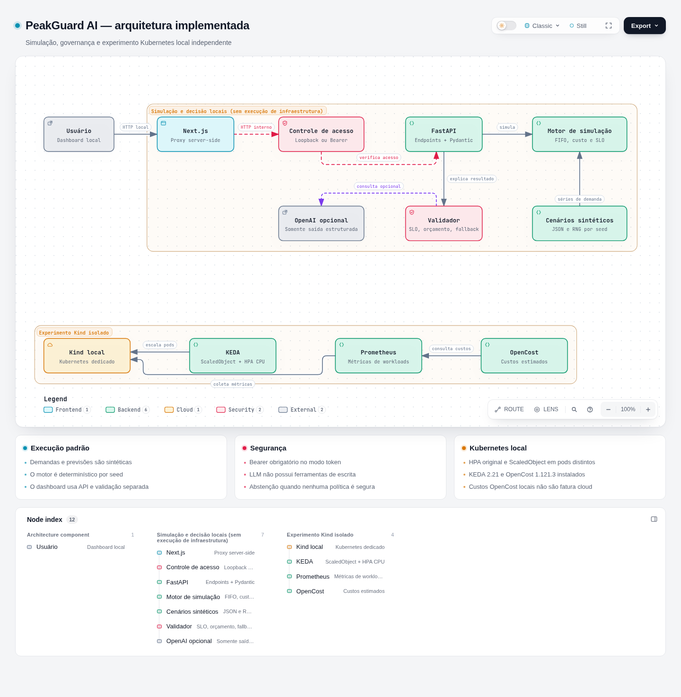
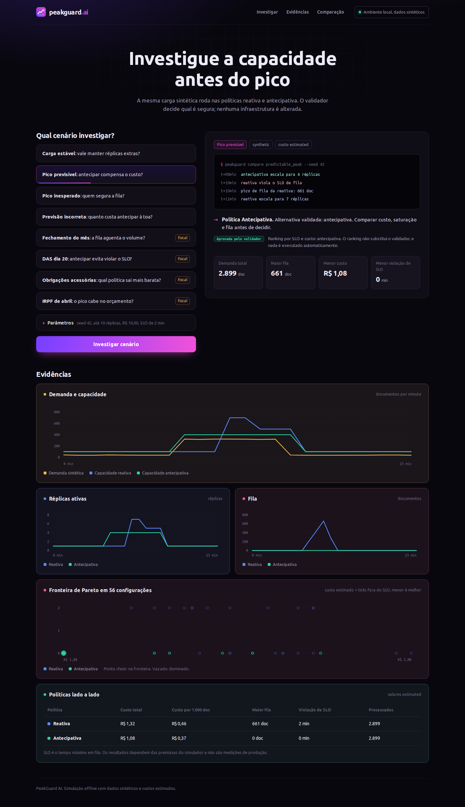
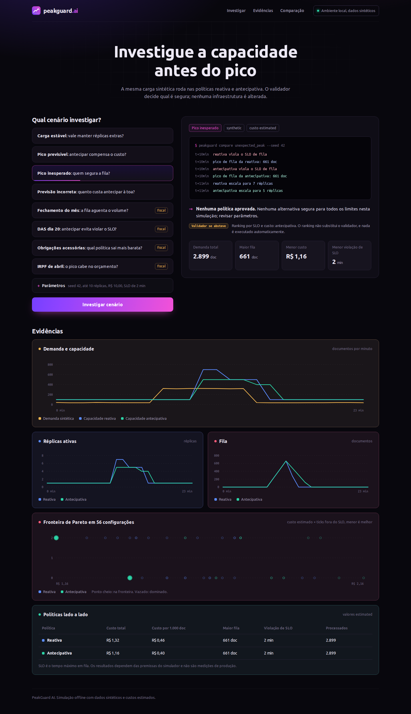
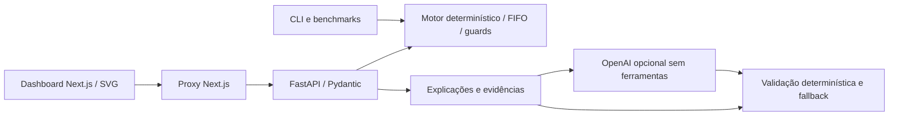
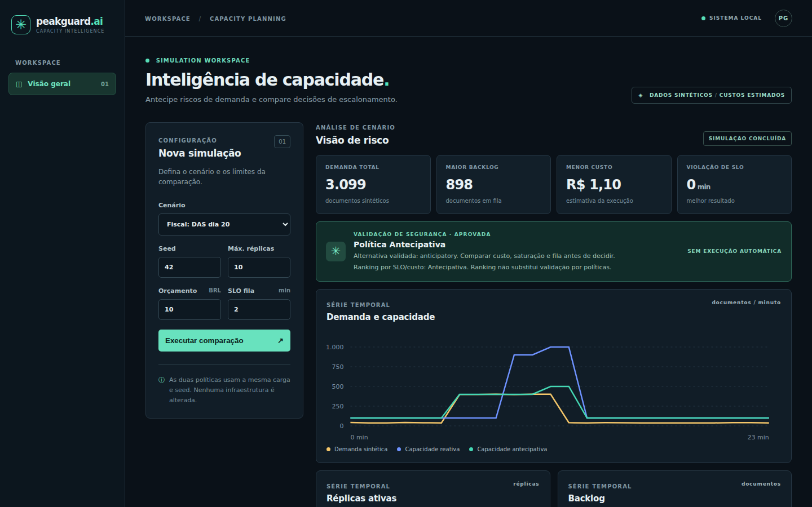
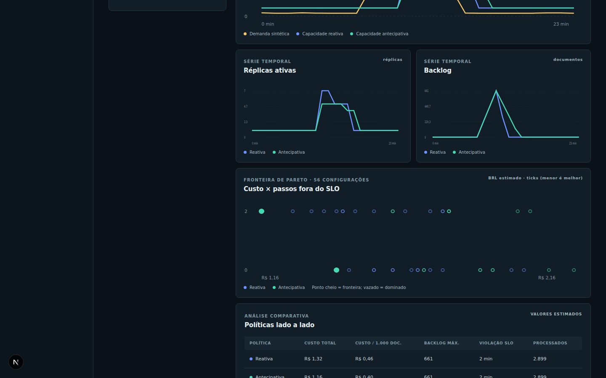

# PeakGuard AI

[](https://github.com/marcocristofolini/peakguard-ai/actions/workflows/ci-python.yml)
[](https://github.com/marcocristofolini/peakguard-ai/actions/workflows/ci-frontend.yml)
[](https://github.com/marcocristofolini/peakguard-ai/actions/workflows/codeql.yml)
[](LICENSE)

[](.archify/architecture-peakguard-ai-20261101-112333/peakguard-architecture.html)

[Explorar a arquitetura interativa (HTML Archify)](.archify/architecture-peakguard-ai-20261101-112333/peakguard-architecture.html) · [Diagrama explicado](docs/ARCHITECTURE.md) · [Segurança e autenticação](docs/SECURITY.md)

Demonstrador local de capacidade, confiabilidade e FinOps para processamento de documentos. Compara escalonamento reativo e antecipativo sob a mesma carga, expõe risco de SLO e custo estimado e permite uma seleção assistida por LLM sujeita a validação determinística.

Projeto independente: não usa sistemas ou dados internos de terceiros. Dados de demanda são **sintéticos**; simulações e custos são **estimados**. Há métricas **observadas** de um ensaio Kind local, sem alegação de economia em produção.



Quando nenhuma política satisfaz as regras de segurança, o dashboard apresenta uma abstenção explícita:



## Executar a demonstração

Pré-requisitos: Linux/WSL2, Python 3.12+, Node.js 22+ e npm. Docker/Kind não são necessários para dashboard, API, explicações offline ou benchmarks. Execute a partir da raiz do checkout. A instalação inicial requer internet.

Terminal 1 — instalar em diretório temporário, sem venv nem instalação global, e iniciar a API:

```bash
python3 -m pip install --target /tmp/peakguard-test-deps '.[dev,llm]'
PYTHONPATH=/tmp/peakguard-test-deps python3 -m uvicorn peakguard.api:app --host 127.0.0.1 --port 8000
```

O extra `llm` instala o adaptador opcional e permite testar o SDK sem rede; não habilita chamadas ao provedor. Use um diretório temporário vazio na primeira instalação; para repetir uma instalação já existente sem misturar versões, escolha outro caminho e ajuste `PYTHONPATH`.

Terminal 2 — dashboard:

```bash
cd frontend
npm ci --ignore-scripts
npm run dev -- --hostname 127.0.0.1
```

Abra `http://localhost:3000`. Selecione **Pico previsível**, seed **42**, e execute a comparação. Teste também **Previsão incorreta** para mostrar que antecipar pode custar mais. Gráficos e tabela usam a API real, não métricas embutidas no frontend.

API: `http://127.0.0.1:8000/docs`; esquema OpenAPI: `/openapi.json`. Para outro backend, defina `PEAKGUARD_API_URL` no ambiente do servidor Next.js. Encerre os dois processos com Ctrl+C. Para build de produção local: `npm run build` e `npm run start -- --hostname 127.0.0.1` em `frontend/`.

## Executar com Docker

```bash
export PEAKGUARD_API_TOKEN=$(openssl rand -hex 32)
docker compose up --build
```

Abra `http://127.0.0.1:3000`. A API fica em modo `token` (o modo `local` só aceita loopback, o que não vale entre containers); o web usa o mesmo token no servidor via `PEAKGUARD_BACKEND_TOKEN`. Portas publicadas só em `127.0.0.1`; não há LLM nem cloud. Detalhes e prova em [docs/VERIFICATION.md](docs/VERIFICATION.md).

## Componentes implementados



[Arquitetura detalhada e limites](docs/ARCHITECTURE.md). A demonstração Kind/HPA/Prometheus é separada: a IA e a API não executam ações em clusters. O dashboard exibe o ranking por SLO/custo separado da seleção validada pelo backend (`/explanations`). Se nenhuma política atender aos limites, mostra abstenção; se a validação falhar, não presume aprovação. A API continua disponível para inspeção detalhada da auditoria.

| Interface | Uso |
| --- | --- |
| `GET /scenarios` | Oito cenários sintéticos: quatro de referência e quatro do calendário fiscal |
| `POST /simulations` | Uma política; `policy=reactive` ou `anticipatory` |
| `POST /comparisons` | Duas políticas com entradas e parâmetros iguais |
| `POST /evidence` | Consulta sem persistência de evidências calculadas |
| `POST /explanations` | Seleção, justificativas verificadas e auditoria |
| `POST /error-budget` | Error budget, burn rate multi-janela, custo por minuto preservado; aceita `risk_appetite` (p50/p80/p90) |
| `POST /pareto` | Varredura de 56 configurações e fronteira custo × ticks fora do SLO |
| `POST /finops` | Custo estendido (nós, ocioso, spot, scale-to-zero) com preços hipotéticos |
| `POST /manifest-diff` | Diff HPA/ScaledObject para PR; nada é aplicado |

O corpo aceita `scenario`, `seed` e `config` opcional. Parâmetros e fórmulas: [contrato da simulação](docs/SIMULATION.md). Entradas inválidas retornam HTTP 422.

```bash
curl -fsS http://127.0.0.1:8000/explanations -H 'Content-Type: application/json' -d '{"scenario":"predictable_peak","seed":42}'
python3 -m peakguard compare wrong_forecast --seed 42 --output /tmp/peakguard-comparison.json
python3 -m peakguard multiseed fiscal_irpf_april --arrivals poisson --seeds 20 --csv /tmp/peakguard-irpf.csv
```

`--arrivals poisson|burst` sorteia chegadas de forma reproduzível pela seed (o padrão continua determinístico); a API aceita `arrivals`, `ewma_window` e `config.decision_delay_ticks`, e o dashboard expõe chegadas e percentil de risco. `multiseed` resume as métricas com média e IC 95% e checa a Lei de Little nas execuções drenadas. Todos os cenários são sintéticos.

## Autenticação da API

Por padrão, `PEAKGUARD_AUTH_MODE=local` permite apenas clientes loopback. Para exigir autenticação Bearer em todas as rotas, defina `PEAKGUARD_AUTH_MODE=token` e um `PEAKGUARD_API_TOKEN` aleatório com pelo menos 32 caracteres. O proxy Next pode usar `PEAKGUARD_BACKEND_TOKEN` no servidor, mas **o dashboard não autentica usuários finais**; não o publique sem proteção de acesso no gateway. Consulte [SECURITY.md](docs/SECURITY.md) para exemplos, TLS e limites.

## IA, segurança e modo offline

O padrão é `offline`, sem chave ou LLM. Para habilitar IA, configure `OPENAI_API_KEY`, `PEAKGUARD_LLM_MODEL` com modelo compatível com Structured Outputs e `PEAKGUARD_LLM_ENABLED=true` no ambiente da API; acrescente `"use_llm":true` ao corpo. `.env.example` contém nomes, não valores reais; o arquivo não é carregado automaticamente. Chamadas habilitadas podem ser cobradas pelo provedor.

A IA recebe contexto selecionado da simulação, sem ferramentas, arquivos ou credenciais. Seleciona políticas existentes e cita IDs/valores exatos; o servidor renderiza justificativas a partir das alegações verificadas. Falha do provedor, resposta inválida, fatos sem suporte ou violação de min/max, orçamento ou SLO acionam fallback sujeito às mesmas regras. Sem alternativa segura, `proposal=null`.

A resposta retorna `mode`, evidências, hash e `audit`, sem persistência automática. `execution_allowed=false` e `human_approval_required=true`: nenhuma ação de infraestrutura está implementada. A API é local, sem autenticação/rate limiting de produção; não publicar como serviço seguro por padrão.

## Benchmark reproduzível

```bash
python3 -m peakguard.benchmarks --output /tmp/peakguard-benchmark
```

108 comparações/216 execuções, quatro cenários, três seeds, três escalas de previsão e três preços. Produz `report.json`, tabela completa `comparison.md` e gráfico nominal `comparison.svg`. Veja [método, resultados negativos e limitações](docs/BENCHMARKS.md). No ponto nominal, o falso positivo custa em média BRL 0,48 reativo contra BRL 1,02 antecipativo. No pico inesperado, ambas violam SLO por 2 minutos. São estimativas do modelo.

## Resultados v2 (P9–P13)

Dados sintéticos e valores estimados, exceto a calibração (métricas observadas no Kind local). Cada número aponta para o artefato que o gera; `evidence/p14/results.json` é reproduzível com `PYTHONPATH=. python3 local/p14/results.py` e conferido por `tests/test_p14.py`.

| Tema | Resultado | Artefato |
| --- | --- | --- |
| Cenário fiscal (DAS dia 20, seed 42) | Reativa: 2 min de SLO violado, R$ 1,52. Antecipativa: 0 min, R$ 1,10. A previsão do calendário é declarada, não aprendida | `evidence/p14/results.json` (`fiscal_seed42`) |
| Multi-seed (IRPF de abril, Poisson, 20 seeds) | Custo reativo R$ 1,746 (IC 95% 1,724–1,768) contra R$ 1,640 antecipativo; backlog máximo 481,75 contra 0 doc | `evidence/p14/results.json` (`irpf_poisson_20_seeds`); `python3 -m peakguard multiseed` |
| Error budget (pico inesperado, chegadas `burst`, seed 1) | p50 consome 4 min (16,7× o budget de 0,24 min; alerta rápido no tick 12). p90 consome 0 min e custa R$ 0,28 a mais (R$ 0,07 por minuto preservado) | `evidence/p14/results.json`; `tests/test_p10.py` |
| Pareto custo × ticks fora do SLO (seed 42) | 56 configurações. Em `unexpected_peak`, a fronteira tem 16 configurações, todas antecipativas, que se resumem a 2 pontos distintos de custo × ticks; em `wrong_forecast`, 12 configurações, todas reativas, num único ponto. Configurações com o mesmo resultado aparecem sobrepostas no gráfico | `evidence/p14/results.json` (`pareto_seed42`); [captura](docs/p14-pareto.png) |
| Governança | Regras em `peakguard/rules.yaml`; número fora das evidências ou URL no texto da LLM rejeita a resposta; diff de manifesto sem chamar o cluster | `tests/test_p12.py`; [VERIFICATION](docs/VERIFICATION.md) |
| Calibração (Kind v1.36.4, 3 repetições) | Capacidade medida 4,9 doc/s por réplica (294 doc/min) e startup mediano de 12 s. Os parâmetros calibrados **não reduziram** o erro (MAE de backlog 36,5 → 41,3 doc). A hipótese seguinte (atraso de decisão do HPA de 20–30 s) **também não se sustentou** (veja v3 abaixo) | `docs/CALIBRATION.md`; `evidence/p13/calibration.json` |





Sem benchmark reproduzível em produção, nada acima é economia real nem ganho de confiabilidade. Detalhes por fase em [CHANGELOG](CHANGELOG.md).

## Resultados v3 (P15–P17)

Mesmos rótulos da v2: demanda `synthetic`, simulação `estimated`, métricas do cluster `observed` (Kind local, 1 nó, 3 repetições), custo sempre hipotético (R$ 1,2 por réplica-hora × minutos de pods prontos).

| Tema | Resultado | Artefato |
| --- | --- | --- |
| Atraso de decisão (P15) | `Config.decision_delay_ticks` (padrão 0) separa a decisão do HPA do startup. O atraso derivado das medições é **0 ticks**: o 1º pod nasce 12,8 / 1,1 / 8,4 s depois do degrau de carga, já coberto pelo tick embutido na reativa. Os 20–30 s da hipótese da P13 vinham de não descontar os 20 s iniciais de carga baixa. MAE de backlog continua 41,3 doc (antigo 36,5); sensibilidade de 1 e 2 ticks (36,4 e 44,8) não foi adotada | `docs/CALIBRATION.md`; `evidence/p15/calibration.json`; `tests/test_p15.py` |
| Paridade da API (P16) | A API aceita `arrivals`, `ewma_window` e `config.decision_delay_ticks`; o dashboard expõe chegadas e percentil de risco. Padrão idêntico às respostas anteriores | `tests/test_p16.py` |
| HPA × antecipativa no Kind (P17) | HPA reativo: backlog máximo 166 doc (171; 145; 182), 1ª escala +30,7 s após o início da carga, 9,14 réplicas-minuto. ScaledObject KEDA (cron do calendário + CPU como piso): backlog máximo 3,3 doc, 1ª escala −32,7 s, 12,08 réplicas-minuto (+32%, custo hipotético R$ 0,24 contra R$ 0,18). O motor previu 142 e 0 doc; divergências em `docs/KUBERNETES.md` | `evidence/p17/results.json`; `docs/KUBERNETES.md` |

Leitura: a antecipativa trocou custo por fila, mas com previsão perfeita (o calendário conhece a curva) e uma única curva de carga. O cenário de previsão errada não foi medido no cluster. Resultado negativo mantido: o atraso de decisão **não** explica o erro de calibração. Nada acima é economia real nem ganho de confiabilidade em produção. A chamada real à LLM (P18) não foi executada por falta de chave.

## Próximos passos

- **Chamada real à LLM (P18):** nunca executada (sem chave no ambiente); falta registrar tokens, latência e custo em `docs/VERIFICATION.md` (procedimento em `local/p12/real_llm_call.py`).
- **Filas por pod:** é a hipótese pendente da calibração. O atraso de decisão derivado das medições é 0 ticks (P15), então o erro restante vem do FIFO central e das taxas fluidas do motor, contra filas independentes por pod no cluster. Não testada.
- **Previsão errada no Kubernetes:** a P17 mediu a antecipativa só com o calendário correto; falta o caso `wrong_forecast` no cluster e com mais de uma curva de carga.
- **Cenários e previsão:** previsões são calendários declarados, não um modelo treinado.
- **OpenCost:** não reinstalado no cluster v1.36.4 (a P17 instalou só o KEDA 2.21).
- **Produção:** revisão independente, autenticação de usuários no dashboard e durabilidade de filas.

## Verificação

```bash
PYTHONPATH=/tmp/peakguard-test-deps python3 -m pytest -q
cd frontend
npm test
npm run build
npm audit
```

O mesmo conjunto roda no GitHub Actions a cada PR e push na `main` (`ci-python`, que também confere se os benchmarks commitados são reproduzíveis, e `ci-frontend`), junto com CodeQL e revisão de dependências.

[Registro de verificação](docs/VERIFICATION.md), [roteiro de cinco minutos](docs/DEMO.md) e [status](docs/STATUS.md). O roteiro inclui rejeição de proposta insegura e distingue análise offline, SDK com transporte simulado e provedor real opcional.

## Kubernetes local opcional

[Procedimento, limites, limpeza e evidências](docs/KUBERNETES.md). Com Docker, kubectl e Kind disponíveis:

```bash
bash local/p6/up.sh
python3 local/p6/experiment.py
bash local/p6/down.sh
```

O ensaio P6 original processou 1.120 documentos e escalou de 1 para 4 pods. Suas evidências foram preservadas em `evidence/p6/`. Posteriormente, recriei o Kind local e instalei **KEDA 2.21.0 e OpenCost 1.121.3 (chart 2.5.33)**, com um ScaledObject isolado e Prometheus local. Consulte [Kubernetes](docs/KUBERNETES.md) para comandos e limites; custos seguem estimados. O cluster é efêmero: suba-o só para o ensaio e remova com `down.sh`.

## Limitações

Previsões são calendários declarados, não um modelo treinado. O motor usa fila fluida e resolução de um tick, sem percentis de latência ou falhas reais de máquinas. A política antecipativa não foi implantada no Kubernetes. SLO validado em simulação não garante SLO produtivo. P7 não fez chamada externa paga a LLM; a integração foi exercitada por testes com transporte simulado. A calibração P13 mediu capacidade e startup num único nó Kind e não melhorou o erro do simulador (ver Resultados v2). Testar durabilidade de filas e realizar revisão independente antes de qualquer uso produtivo.

## Roadmap, contribuição e licença

As fases P0–P14 estão concluídas (P12 sem a chamada real à LLM); o histórico por fase está no [CHANGELOG](CHANGELOG.md) e a próxima rodada (P15–P19) no [ROADMAP](ROADMAP.md). Para contribuir, veja o [guia de contribuição](CONTRIBUTING.md) e o [código de conduta](CODE_OF_CONDUCT.md). Vulnerabilidades devem ser relatadas pela [política de segurança](.github/SECURITY.md). Código sob [licença MIT](LICENSE).
