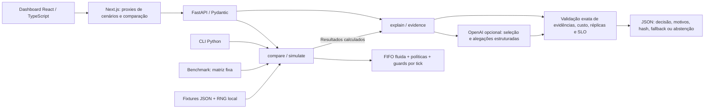
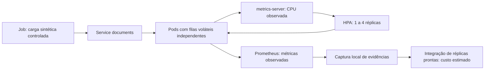

# Arquitetura implementada

A chamada real de `/explanations` primeiro executa `run(request)` na API e depois fornece a comparação calculada a `explain`. O diagrama representa essa dependência lógica; o módulo de explicações não chama o motor por conta própria. O dashboard consulta cenários, comparação e, separadamente, `/explanations` via proxy local. Mostra a aprovação determinística, abstenção ou validação indisponível sem autorizar mudanças de infraestrutura. Não há chat, execução de ferramentas ou controlador Kubernetes ligado à IA.

Kind é uma demonstração separada, sob `local/p6`, não um destino de alterações feitas pela API. Não há banco, broker, autenticação de produção, KEDA, OpenCost, cloud ou framework de agentes.

## Fronteiras e escolhas

- `scenarios.py`: calendário sintético e RNG por seed. Mesma realização imutável alimenta ambas as políticas.
- `simulator.py`: capacidade, ativação, cooldown, FIFO, custos e validação por tick. Não depende de FastAPI ou LLM.
- `api.py`: validações HTTP, limites e chamadas ao motor; não contém uma segunda implementação da simulação.
- `explanations.py` e `llm.py`: o modelo seleciona uma política existente e cita evidências exatas. Justificativas são renderizadas de alegações verificadas. Fallback determinístico passa pelas mesmas regras, ou se abstém.
- `benchmarks.py`: matriz fixa e artefatos JSON/Markdown/SVG, incluindo resultados negativos e falhas.
- `frontend`: formulário, gráficos SVG e tabela. Sem biblioteca de gráficos ou design system adicional.

O ranking da interface minimiza violações e depois custo, mas não equivale à aprovação. O dashboard exibe separadamente a decisão retornada pelo validador do backend, que exige ausência de violações e respeito aos limites. Quando todas as políticas são inseguras, a interface exibe abstenção em vez de recomendar uma delas.

## Limitações e responsabilidade técnica

Fila central fluida no motor difere das filas por pod. Espera tem resolução de um tick; não há percentis de atendimento. Previsão vem de calendário declarado, não de modelo treinado. A política antecipativa real não foi implantada no Kind. Custos são sintéticos/estimados, inclusive quando derivados de réplicas observadas. IA não estima infraestrutura externa nem autoriza alterações.

A API é destinada a localhost: sem autenticação, rate limiting ou proteção para publicação. O proxy usa backend configurado no servidor e não destinos fornecidos pelo usuário. Não exponha publicamente a demonstração como serviço de produção. Auditoria é retornada no JSON, sem persistência automática. Filas Kubernetes podem perder documentos em reinícios/reduções. Testes de segurança são delimitados; não equivalem a uma auditoria independente.

## Revisão de complexidade

O projeto tem um único motor, adaptador LLM isolado e uma integração Kubernetes separada. Não foram encontrados serviços ou frameworks adicionais que justificassem remoção nesta revisão. Arquivos de evidência são mantidos por rastreabilidade. Código compacto do frontend e respostas HTTP com dicionários amplos são pontos de manutenção futura; não se promoveu refatoração extensa durante a preparação da entrevista.
