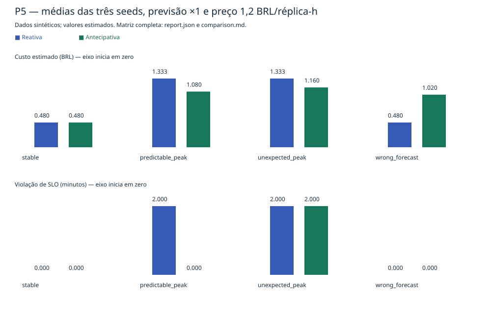

# Benchmark P5

## Reprodução

Na raiz, Python 3.12+, sem LLM ou serviços externos:

```bash
python3 -m peakguard.benchmarks --output benchmarks/results
python3 -m peakguard.benchmarks --output /tmp/peakguard-p5-replay
diff -qr benchmarks/results /tmp/peakguard-p5-replay
PYTHONPATH=/tmp/peakguard-test-deps python3 -m pytest tests/test_benchmarks.py -q
```

`report.json` guarda entradas, hashes SHA-256 de demanda e fixtures, configurações, métricas e deltas. `comparison.md` contém todas as linhas por política. `comparison.svg` mostra médias nominais das três seeds para todos os quatro cenários. Nenhuma seed ou cenário é descartado. Erros ficam no JSON, são sinalizados na tabela/gráfico e fazem a CLI terminar com código 1.

## Desenho e premissas

108 pares, 216 execuções: quatro fixtures × seeds 7/42/101 × multiplicadores de previsão 0,5/1/1,5 × preços 0,6/1,2/2,4 BRL/réplica-hora. A previsão declarada é multiplicada sem consultar a demanda realizada. Carga e seed permanecem iguais entre políticas e entre os pontos de sensibilidade. A política reativa ignora a previsão por definição.

Cada execução usa 24 ticks de um minuto; demais parâmetros são `Config()` e constam integralmente no relatório. Não há ajuste de parâmetros por política. A matriz foi fixada antes de executar os experimentos. O ponto nominal é multiplicador 1 e preço 1,2; os gráficos não representam toda a matriz, disponível nos arquivos JSON e Markdown.

## Resultados nominais

Médias das três seeds. Custos em BRL estimados; SLO em minutos por execução. Backlog é a média dos máximos de cada execução, em documentos.

| Cenário | Custo reativo | Custo antecipativo | SLO reativo | SLO antecipativo | Backlog máx. reativo | Backlog máx. antecipativo |
| --- | --- | --- | --- | --- | --- | --- |
| stable | 0,4800 | 0,4800 | 0 | 0 | 0 | 0 |
| predictable_peak | 1,3333 | 1,0800 | 2 | 0 | 659,3333 | 0 |
| unexpected_peak | 1,3333 | 1,1600 | 2 | 2 | 659,3333 | 659,3333 |
| wrong_forecast | 0,4800 | 1,0200 | 0 | 0 | 0 | 0 |

No pico previsível, a antecipação reduz fila e violação neste modelo. No pico inesperado, ambas as políticas violam SLO: custo menor não implica confiabilidade suficiente. Na previsão falsa, antecipar custa BRL 0,54 a mais por execução nominal sem melhorar fila ou SLO. A carga estável empata. Não existe uma política vencedora universal nestes resultados.



## Sensibilidade

A preço 1,2, a política antecipativa na previsão falsa custa, em média, BRL 0,66/1,02/1,38 para os multiplicadores 0,5/1/1,5. O MAE correspondente é 48,6111/83,1111/143,3056 documentos/minuto. No pico previsível, custa BRL 1,10/1,08/1,50; subprevisão também pode custar mais pelo ajuste posterior. No pico inesperado, os três multiplicadores mantêm 2 minutos de violação e BRL 1,16 de custo médio. MAE isolado não determina risco: tempo e distribuição do erro também importam.

Nesta faixa de preços, o orçamento de BRL 10 não se torna restritivo; dobrar o preço dobra o custo, mantendo trajetória e SLO. Isso mede sensibilidade ao preço estimado, sem custo de LLM, operação humana ou infraestrutura externa. Não extrapolar esse comportamento para orçamento restritivo.

## Métricas e limitações

Throughput médio = documentos processados / duração em minutos. Backlog médio = média por tick (ticks regulares); backlog máximo e residual também são reportados. Saturação e SLO são somas de ticks marcados multiplicadas por sua duração. Custo = réplica-horas × BRL/réplica-hora, incluindo réplicas pendentes; custo por 1.000 = custo × 1.000 / documentos processados (`null` se zero). Delta = antecipativa − reativa, sem conversão oportunista em percentuais. `failures` classifica SLO violado e fila residual; isso é diferente de erro de execução do experimento.

Unidades, conservação e fórmulas são verificadas automaticamente. As saídas são determinísticas e não incluem relógio ou tempo de execução como métrica. Reproduzir na mesma versão do código e runtime; a precisão float pode variar entre ambientes. Hashes de fixtures detectam alterações de cargas declaradas.

As cargas são sintéticas, previsões são declaradas e todos os resultados são estimados. Nenhum dado produtivo foi observado. O modelo fluido FIFO tem resolução de um tick; não modela percentis, variabilidade de atendimento, falhas de máquina ou custo real de cloud. Há apenas três seeds e quatro formatos de carga; não há intervalo de confiança ou alegação de significância estatística. A fila residual não é drenada depois do horizonte. São evidências reproduzíveis do simulador, não comprovação de economia ou confiabilidade em produção.
